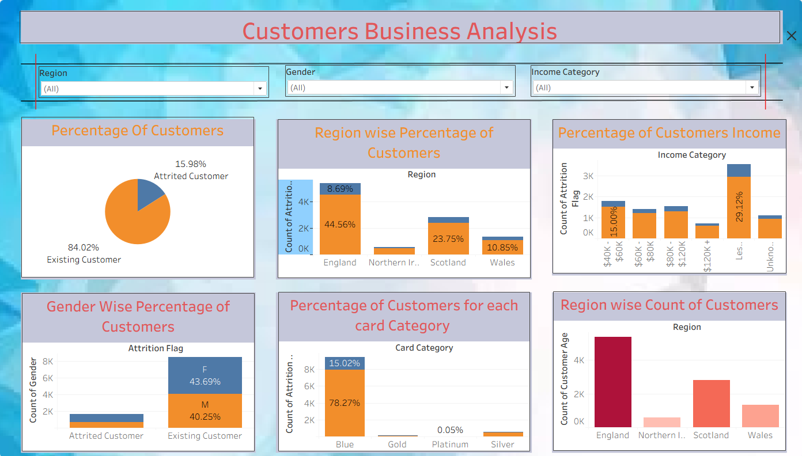

# Customer Attrition Analysis: Tableau Capstone Project

**Tableau | Python (Jupyter Notebook) | Data Cleaning | Customer Analytics**

Prepared by **Shubham Shah**

---



> The dashboard has three filters (Region, Gender, Income Category) that update every chart.

---

## 1. Project Overview

This is a Tableau capstone project (course code DA153S15). A company wants to understand which customers leave (attrite) and how its customer base is spread across regions, genders, income groups and card categories. The data is first prepared in **Python (Jupyter Notebook)**, then analysed and presented in **Tableau**, and finally summarised in a PowerPoint report.

The project answers:
- What share of customers have attrited vs still exist?
- How does attrition differ by gender, region, card category and income category?
- Which region has the most customers?
- What further patterns (open-to-buy, age, credit limit, transactions, dependents) can be drawn from the data?

The stated objective is to show how Tableau can turn raw data into actionable information for decision-making.

---

## 2. Dataset

| Item | Detail |
|---|---|
| Records | 10,127 customers |
| Columns | 20 |
| Source file in the notebook | `DS1_C8_V3_ND_Sprint3_BankChurn_Data.csv` |
| Cleaned file for Tableau | `Capstone_Project_Tableau.csv` (written by the notebook) |
| Target | `Attrition_Flag` (Existing Customer / Attrited Customer) |

**Columns:** CLIENTNUM, Attrition_Flag, Customer_Age, Gender, Dependent_count, Education_Level, Marital_Status, Income_Category, Card_Category, Region, Months_on_book, Total_Relationship_Count, Months_Inactive_12_mon, Contacts_Count_12_mon, Credit_Limit, Total_Revolving_Bal, Avg_Open_To_Buy, Total_Trans_Amt, Total_Trans_Ct, Avg_Utilization_Ratio.

---

## 3. Data Preprocessing in Python (`Telecom_data_Python.ipynb`)

The notebook prepares the data before it is loaded into Tableau:

1. **Import** the data with pandas and check shape (10,127 rows x 20 columns), `head()`, `describe()` and `info()`.
2. **Split columns** into numeric and categorical with a small helper function (shown as a table using `tabulate`).
3. **Outlier analysis:** box plots for every numeric column. The notebook notes outliers in Total_Trans_Ct, Total_Trans_Amt, Avg_Open_To_Buy, Credit_Limit, Contacts_Count_12_mon, Months_Inactive_12_mon, Months_on_book, Dependent_count and Customer_Age.
4. **Missing values:** the null check found 132 missing in `Card_Category` and 60 missing in `Credit_Limit`.
   - `Card_Category` was filled with its mode, **Blue**.
   - `Credit_Limit` was filled with 8,703.1 (the column mean).
5. **Verify** that no nulls remain, then **save** the cleaned file as `Capstone_Project_Tableau.csv` for Tableau.

---

## 4. Requirements

**Functional**
- Clean data with no missing values for the key fields.
- Percentage of attrited vs existing customers overall and by gender, region, card category and income category.
- Region-wise customer count.
- An interactive dashboard with filters.
- Five to ten extra analyses with interpretations.

**Technical**
- Tableau Desktop to open `Telecom_Data_Tableau.twbx` (a packaged workbook with the data extract inside).
- Python 3 with pandas, numpy, matplotlib, seaborn and tabulate to run the notebook.
- PowerPoint to view the report.

---

## 5. Tools and Technologies

| Area | Used |
|---|---|
| Data preparation | Python, Jupyter Notebook, pandas, numpy, matplotlib, seaborn, tabulate |
| Visualization | Tableau Desktop (packaged workbook `.twbx`) |
| Tableau features | Percent-of-total calculations, a calculated age bin, stacked bars, pie charts, histograms, filters, two dashboards |
| Reporting | PowerPoint (`Telecom_data_Report.pptx`) |

---

## 6. Tableau Tasks Completed

| Task | What was built |
|---|---|
| Task 1 | Percentage of attrited vs existing customers (pie chart) |
| Task 2 | Gender-wise percentage of attrited and existing customers |
| Task 3 | Region-wise percentage of attrited and existing customers |
| Task 4 | Percentage of attrited and existing customers by card category |
| Task 5 | Percentage of attrited and existing customers by income category |
| Task 6 | Region-wise count of customers and the region with the most customers |
| Task 7 | Interactive dashboard (Dashboard 1) with the six charts above and filters |
| Task 8 (A-F) | Extra analyses: income category-wise average open-to-buy; age-wise count of card category; region-wise transaction amount; age-wise average credit limit; region-wise transaction share; region-wise dependents of customers, plus a second dashboard (Dashboard 2) |

---

## 7. Approach

1. **Understand the objective** from the capstone brief and plan the eight tasks.
2. **Explore and clean** the data in the Python notebook (types, outliers, missing values).
3. **Load the cleaned CSV** into Tableau and build one worksheet per task.
4. **Build the dashboard** ("Customers Business Analysis") with Region, Gender and Income Category filters.
5. **Add extra analyses** (Task 8) and a second dashboard.
6. **Write conclusions** for each chart and assemble them in the PowerPoint report.

---

## 8. Challenges Faced

| Challenge | How it was handled |
|---|---|
| **Missing values** in Card_Category (132) and Credit_Limit (60). | Filled Card_Category with the mode (Blue) and Credit_Limit with the mean. Credit limit is skewed (mean 8,703 vs median 4,557), so the median would be a more conservative choice. |
| **Outliers** in many numeric columns (for example Dependent_count has a maximum of 143, which looks like a data-entry error). | Identified them with box plots and kept the records; flagged for validation with the data owner. |
| **Percentages vs counts in Tableau:** showing the share of attrited vs existing customers inside each group. | Used percent-of-total calculations on stacked bar charts, with labels. |
| **Many categories and filters on one dashboard.** | Grouped related charts, placed the three filters in one row at the top and applied them to all charts. |
| **Packaging** the Tableau workbook with its data. | Saved as a packaged workbook (`.twbx`) so the extract travels with the file. |

---

## 9. Key Insights

Figures are read from the dashboard and the notebook.

- **Overall attrition:** 15.98% of customers have attrited and 84.02% are existing customers.
- **Region:** England has the most customers (about 53% of the base: 44.56% existing plus 8.69% attrited), then Scotland (23.75% existing) and Wales (10.85% existing). Northern Ireland is the smallest.
- **Transactions follow the same order:** England 53.16%, Scotland 28.12%, Wales 13.17%, Northern Ireland 5.55%.
- **Card category:** Blue is by far the most common card (78.27% existing plus 15.02% attrited, about 93% of customers); Gold, Silver and Platinum (0.05%) are very small.
- **Income:** the "Less than $40K" group is the largest (29.12% existing customers), followed by $40K - $60K (15.00%); the $120K+ group is the smallest.
- **Open-to-buy:** average open-to-buy rises with income and is highest for $120K+ customers and lowest for "Less than $40K".
- **Gender:** among existing customers women are 43.69% and men 40.25% of the base.
- **Age:** customers are concentrated in their 40s and early 50s (mean age 46.4, median 46).
- **Credit limit:** the average is 8,703 but the median is 4,557, so a few very high limits pull the average up.
- **Dependents:** England also has the most dependents recorded, in line with it having the most customers.

> The charts show where customers are, and how attrited and existing customers split in each group. Because group sizes differ, a bigger "attrited" bar does not by itself mean a higher attrition rate.

---

## 10. Recommendations

1. **Focus retention on the biggest groups first:** England and Scotland, "Less than $40K" income customers and Blue card holders hold most customers and so most attrition in absolute terms.
2. **Track attrition rate per segment,** not only counts, so small high-risk groups are not missed.
3. **Grow higher-value segments:** customers earning $80K+ have much higher open-to-buy (spending headroom), so target them with upgrade and rewards offers.
4. **Review the card mix:** more than 90% of customers hold Blue, so Silver / Gold upgrade offers are a clear opportunity.
5. **Use the unused behaviour fields:** months inactive, contact count, transaction amount and count are in the data and are strong candidates for explaining attrition; add them to the next version of the dashboard.
6. **Build a simple attrition model** (for example logistic regression) to flag at-risk customers early.
7. **Improve data quality:** validate the Dependent_count outliers, document how missing values are imputed, and consider median imputation for the skewed credit limit.
8. **Refresh regularly:** re-run the notebook and refresh the Tableau extract as new data arrives.

---

## 11. How to Use

1. Download the repository and keep all files in one folder.
2. Open `Telecom_Data_Tableau.twbx` in Tableau Desktop and explore the worksheets and dashboards; use the Region, Gender and Income Category filters.
3. Open `Telecom_data_Python.ipynb` in Jupyter to see the preprocessing. Update the input and output file paths in the first and last cells to your own folders.
4. Open `Telecom_data_Report.pptx` for the task-by-task conclusions.

---

## 12. Limitations

- One snapshot of customers, so there are no trends over time.
- Missing values were imputed with simple rules (mode and mean).
- Outliers are flagged but not removed.
- Charts show shares and counts; they do not by themselves prove why customers leave.

---

## 13. Repository Structure

```
Customer-Attrition-Analysis-Tableau
|-- Dashboard_SS.png
|-- Telecom_Data_Tableau.twbx
|-- Telecom_data_of_California.csv
|-- Telecom_data_Python.ipynb
|-- Telecom_data_Report.pptx
`-- README.md
```

| File | Description |
|---|---|
| `Dashboard_SS.png` | Screenshot of the "Customers Business Analysis" dashboard |
| `Telecom_Data_Tableau.twbx` | Packaged Tableau workbook (worksheets for Tasks 1-8 and the dashboards) |
| `Telecom_data_of_California.csv` | Telecom customer dataset (1,877 customers, 25 columns including contract, internet type, tenure, monthly charge and churn reason). Its columns are different from the dashboard's data, so it is documented here as a separate file. |
| `Telecom_data_Python.ipynb` | Jupyter Notebook for data preprocessing |
| `Telecom_data_Report.pptx` | Project report with the output and conclusion for each task |
| `README.md` | Project documentation (this file) |

---

## Author

**Shubham Shah**
Tableau | Python | Data Analytics Portfolio Project
